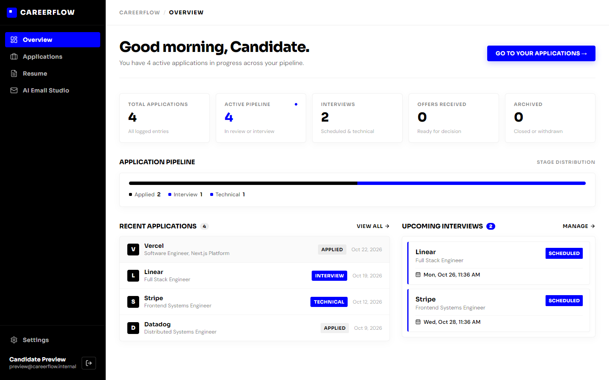
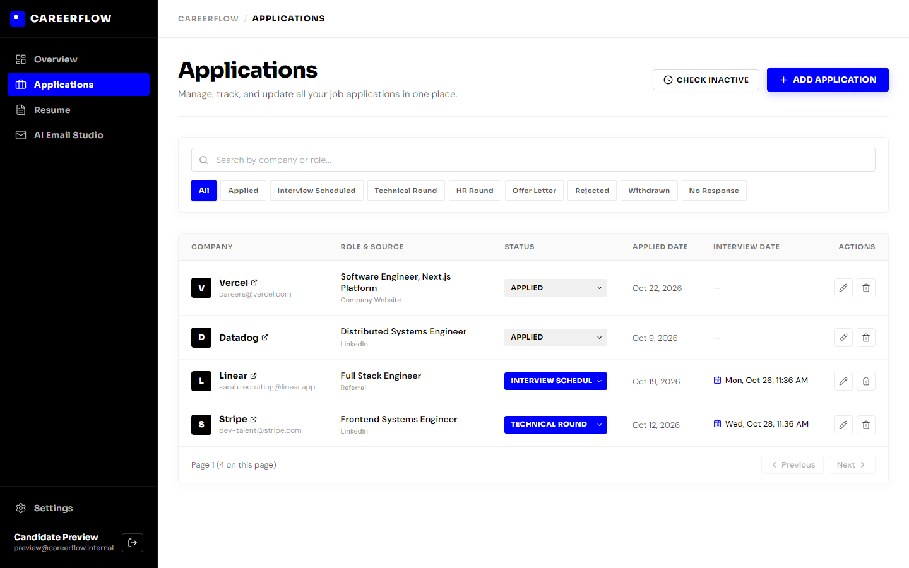
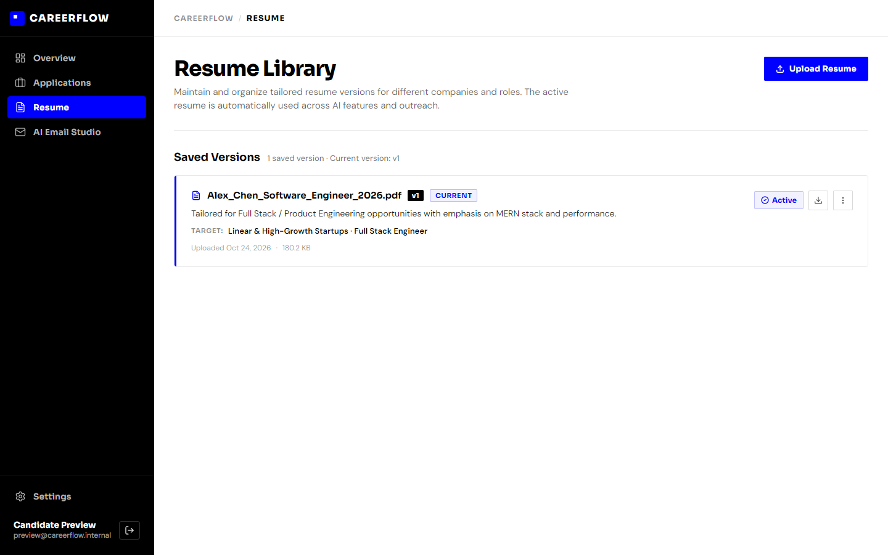
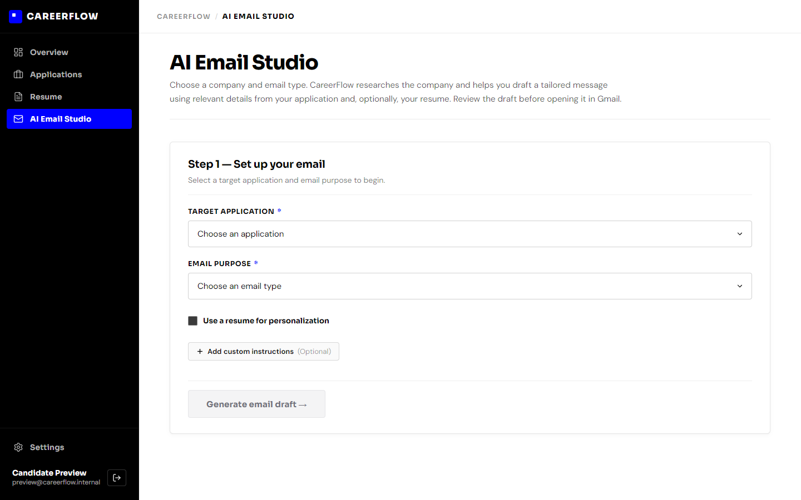
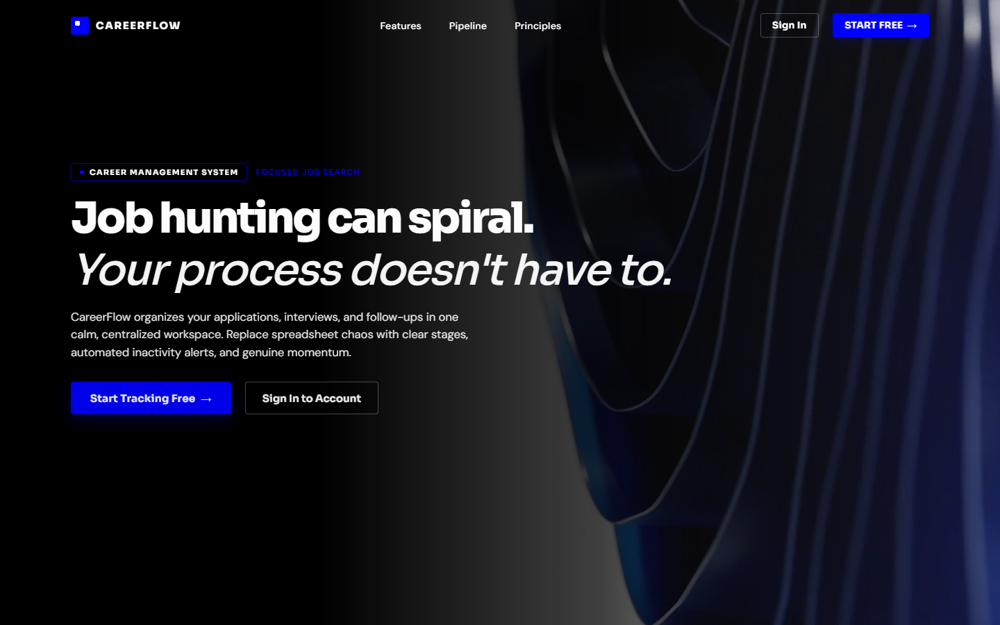
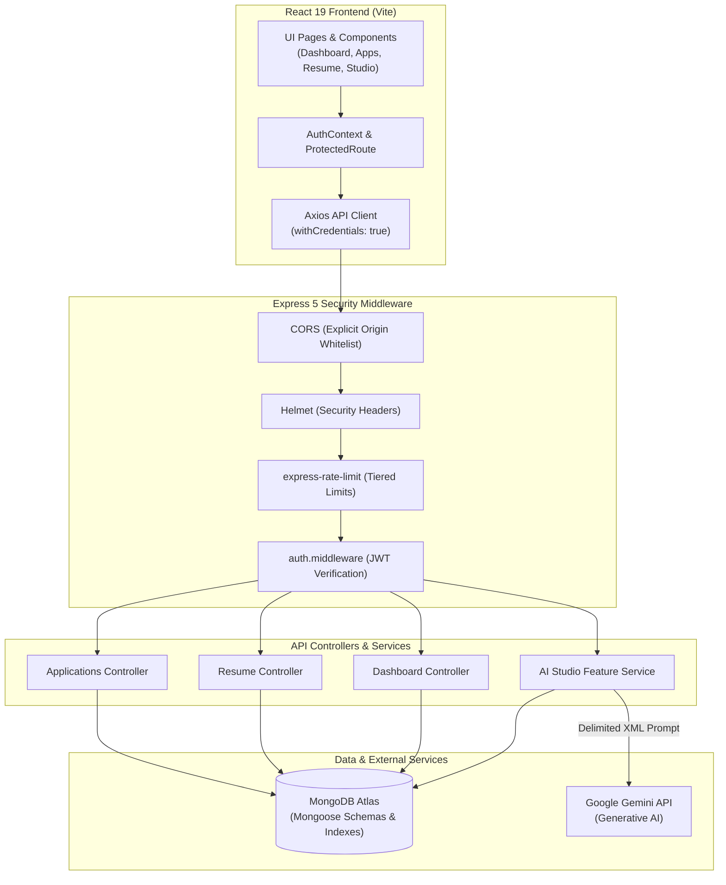

# CareerFlow — MERN Stack Job Application Tracker & Career CRM

[](https://nodejs.org/)
[](https://react.dev/)
[](https://expressjs.com/)
[](https://www.mongodb.com/)
[](https://ai.google.dev/)
[](server/test/security.test.cjs)

A focused, single-user career relationship manager and job application tracking system built with the MERN stack. CareerFlow replaces disorganized spreadsheets and fragmented job search notes with structured pipeline workflows, interview date management, resume version tracking, and AI-assisted recruiter outreach.

Developed as an end-to-end portfolio project to demonstrate clean architecture, robust security controls, modern React state management, and production-grade API design.

---

## Table of Contents

- [Project Overview](#project-overview)
- [Application Screenshots](#application-screenshots)
- [Key Features](#key-features)
- [Tech Stack](#tech-stack)
- [System Architecture](#system-architecture)
- [Project Structure](#project-structure)
- [Getting Started](#getting-started)
- [Environment Variables](#environment-variables)
- [Testing & Security Implementation](#testing--security-implementation)
- [Current Limitations](#current-limitations)

---

## Project Overview

During an active tech job search, candidates frequently juggle dozens of concurrent submissions across job boards, referrals, and company career pages. Common friction points include:

1. **Spreadsheet Bloat:** Manual spreadsheets lack real-time validation, automatic date prompts, and status enforcement.
2. **Missed Interview Follow-ups:** Interview rounds require prompt follow-ups and date tracking that static spreadsheets fail to alert on.
3. **Stale Application Clutter:** Submissions that go cold without a formal rejection clutter active job search queues.
4. **Context Switching for Outreach:** Drafting personalized recruiter follow-ups requires manually re-reading job descriptions, checking company websites, and tailoring resume bullet points.

**Why I Built CareerFlow:**
I developed CareerFlow to solve this workflow bottleneck as a personal developer productivity tool and a full-stack portfolio piece. The goal was to build a disciplined, end-to-end MERN application that adheres to:
- A strict, distraction-free aesthetic (high-contrast monochrome palette with electric blue accents `#0000FF`).
- Secure API development patterns (HTTP-only cookie auth, rate-limiting, buffer inspection, multi-tenant query scoping).
- Practical generative AI integration that keeps the user in control rather than automating unverified actions.

---

## Application Screenshots

All screenshots below are captured directly from the live, running application.

### 1. Dashboard Overview
Unified command center highlighting active pipeline velocity, upcoming interviews, stage distribution metrics, and recent application activity.



### 2. Applications Pipeline & Stage Management
Filterable, searchable table supporting stage-by-stage status progression, 10-day inactivity checks, recruiter contact details, and interview date synchronization.



### 3. Resume Library & Version Management
Multi-version resume catalog supporting PDF parsing, active version locking, role-tailored metadata tags, and binary downloads.



### 4. AI Email Studio
Context-aware outreach studio that integrates company research, application details, and active resume context to draft tailored recruiter emails with one-click Gmail handoff.



### 5. Editorial Landing Page
Public landing interface featuring high-contrast typography, interactive product previews, and pipeline feature spotlights.



---

## Key Features

### 1. Stage-by-Stage Application Lifecycle
- Tracks applications across 8 discrete lifecycle statuses: `Applied`, `Interview Scheduled`, `Technical Round`, `HR Round`, `Offer Letter`, `Rejected`, `Withdrawn`, and `No Response`.
- Multi-field search by company name or job role with backend regex metacharacter escaping.
- Server-side status filtering and bounded pagination (`page`, `limit`).

### 2. Mandatory Interview Scheduling
- Enforces an explicit interview date prompt whenever an application transitions into an interview-related stage (`Interview Scheduled`, `Technical Round`, `HR Round`).
- Dedicated upcoming interviews stack on the dashboard with date formatting, relative countdowns, and quick access to application details.

### 3. 10-Day Silent Inactivity Detection
- Built-in inactivity check detects applications in `Applied` status that have received no updates for more than 10 days.
- Automatically transitions dormant applications to `No Response` to prevent stale leads from distorting active pipeline metrics.

### 4. Multi-Version Resume Library
- Stores multiple tailored resume iterations per user with auto-incrementing version numbers (`v1`, `v2`, etc.).
- Compound unique index (`user` + `version`) guarantees database-level version integrity.
- In-memory PDF text extraction via `pdf-parse` with a 10-page ceiling to extract structured plain text for AI personalization.
- Secure binary storage in MongoDB using BSON Buffers, allowing direct file downloads with appropriate MIME types.

### 5. AI Email Studio & Company Research
- Integrates Google Generative AI (`gemini-3.1-flash-lite` / `gemini-3.8-flash` via `@google/generative-ai`) to draft tailored communications:
  - Application follow-ups
  - Recruiter check-ins
  - Thank-you notes post-interview
  - Status inquiries
- Performs contextual company research using provided company URLs and notes.
- Secure Gmail handoff: Generates a pre-filled `https://mail.google.com/mail/?view=cm` link with recipient, subject, and encoded body so the user reviews and sends the message personally.

---

## Tech Stack

| Layer | Technology | Purpose |
| :--- | :--- | :--- |
| **Frontend Framework** | React 19.2 | Component-driven UI with modern Hooks and concurrent rendering |
| **Build Tool & Bundler** | Vite 8.3 | High-performance local development server and optimized production bundling |
| **Routing** | React Router v7.18 | Client-side routing with protected route guards and metadata synchronization |
| **Styling & Motion** | Vanilla CSS + Motion 13 | Design system tokens, responsive grid layouts, and hardware-accelerated transitions |
| **Icons & Visuals** | Lucide React + Three.js | Lightweight SVG iconography and hero background canvas rendering |
| **Backend Framework** | Node.js 18+ & Express 5.3 | Modular RESTful API server with custom route controllers and error handling |
| **Database & ODM** | MongoDB Atlas & Mongoose 9.1 | Cloud document database with typed schemas, validation, and compound indexing |
| **Authentication** | JSON Web Tokens & bcryptjs | Stateless session tokens delivered via HTTP-only cookies; salted password hashing |
| **AI Integration** | Google Generative AI SDK | Server-side prompt engineering, company synthesis, and personalized email drafting |
| **Security & Headers** | Helmet & express-rate-limit | HTTP response header hardening, tiered IP-based and user-keyed rate limiting |
| **Document Processing**| pdf-parse 1.1 | Server-side buffer inspection and plain-text extraction from candidate PDF resumes |
| **Testing Suite** | Node.js Test Runner (`node:test`) | Native automated regression test suite covering security controls and edge cases |

---

## System Architecture

CareerFlow is architected as a decoupled client-server application. The React single-page application (SPA) communicates with the Express backend over HTTP/REST with credentials.



### Communication Flow:
1. **Authentication:** The client submits credentials to `/api/auth/login`. On validation, the server generates a signed JWT and sets an `httpOnly`, `sameSite: 'strict'`, `path: '/'` cookie. No tokens are exposed to JavaScript or stored in `localStorage`.
2. **Protected Requests:** Subsequent requests include the cookie automatically. The `protect` middleware verifies the token and attaches the authenticated user record to `req.user`.
3. **Data Scoping:** All database queries in controllers enforce multi-tenant isolation by explicitly querying `{ user: req.user._id, ... }`.
4. **AI Generation:** The backend gathers application notes, active resume text, and research context, formats them inside strict XML delimiters (`<resume_content>`, `<company_context>`), and invokes the Gemini API using an isolated system prompt.

---

## Project Structure

```
Job Application Tracker/
├── client/                          # React frontend SPA
│   ├── public/                      # Static assets (favicons, robots.txt, media)
│   ├── scripts/                     # Build scripts (sitemap generator)
│   ├── src/
│   │   ├── api/                     # Axios HTTP client instances and API endpoint functions
│   │   ├── assets/                  # Images, logos, and UI asset files
│   │   ├── components/              # Reusable UI elements (Navigation, Modals, ProtectedRoute)
│   │   ├── context/                 # AuthContext (user state, login/logout handlers)
│   │   ├── pages/                   # Route views (Landing, Dashboard, Applications, Resume, Communications)
│   │   ├── routes/                  # Navigation links and route configuration
│   │   ├── services/                # Helper utilities and formatting logic
│   │   ├── utils/                   # Frontend helpers (status helpers, date utilities)
│   │   ├── App.jsx                  # Main route switch with ProtectedRoute layout wrappers
│   │   ├── index.css                # Global design system variables and typography
│   │   └── main.jsx                 # React root mount point
│   ├── index.html                   # HTML template with SEO and social metadata
│   ├── package.json                 # Client dependencies and Vite scripts
│   └── vite.config.js               # Vite config with dev proxy and optional SEO plugin
│
├── server/                          # Express backend API
│   ├── src/
│   │   ├── config/                  # Database connection setup (Mongoose connection logic)
│   │   ├── controllers/             # Request handlers (auth, applications, dashboard, resume)
│   │   ├── features/                # Domain services (AI email studio, follow-ups, company research)
│   │   ├── middlewares/             # Middleware (auth verification, rate limiting, error handling)
│   │   ├── models/                  # Mongoose data schemas (User, Application, Resume, Communication)
│   │   ├── routes/                  # Express route declarations (auth, applications, features)
│   │   ├── services/                # External service wrappers
│   │   ├── utils/                   # Utility helpers (regex escaping, file validation)
│   │   ├── app.js                   # Express application setup, CORS, Helmet, and middleware mounting
│   │   └── server.js                # Server entry point and HTTP port listener
│   ├── test/                        # Automated security and regression test suite
│   │   └── security.test.cjs        # 31 automated tests using node:test
│   └── package.json                 # Server dependencies and test scripts
│
├── docs/                            # Documentation assets
│   └── screenshots/                 # Application interface screenshots
└── README.md                        # Project documentation
```

---

## Getting Started

### Prerequisites

Ensure you have the following installed on your local environment:
- **Node.js**: `v18.0.0` or higher (verified on Node `v24.x`)
- **npm**: `v9.0.0` or higher
- **MongoDB**: A running local MongoDB instance or a free MongoDB Atlas connection string
- **Google Gemini API Key**: An active API key from [Google AI Studio](https://aistudio.google.com/)

---

### Installation & Local Setup

#### 1. Clone the repository
```bash
git clone https://github.com/SOHEB-XD/AI-powered-Career-CRM.git
cd AI-powered-Career-CRM
```

#### 2. Install Server Dependencies
```bash
cd server
npm install
```

#### 3. Install Client Dependencies
```bash
cd ../client
npm install
```

---

### Environment Configuration

#### Server Configuration (`server/.env`)
Create a `.env` file inside the `server/` directory:

```env
# Server Network Port
PORT=3000

# MongoDB Connection String (Atlas URI or local mongodb://127.0.0.1:27017/careerflow)
MONGO_URI=mongodb+srv://<username>:<password>@cluster0.mongodb.net/careerflow?retryWrites=true&w=majority

# JWT Signing Secret (Generate a strong random string)
JWT_SECRET=your_super_secret_jwt_key_here_min_32_chars

# Allowed Frontend Origins for CORS (comma-separated if multiple)
CLIENT_URL=http://localhost:5173

# Google Gemini API Key for AI Email Studio & Company Research
GOOGLE_API_KEY=your_google_gemini_api_key_here

# Google OAuth Web Client ID for Google Sign-In verification
GOOGLE_CLIENT_ID=your_google_oauth_client_id.apps.googleusercontent.com

# Environment Mode
NODE_ENV=development
```

#### Client Configuration (`client/.env`)
Create a `.env` file in the `client/` directory:

```env
# Google OAuth Web Client ID for Google Sign-In (public configuration)
VITE_GOOGLE_CLIENT_ID=your_google_oauth_client_id.apps.googleusercontent.com

# Production domain used for generating sitemap.xml and canonical tags (omit in local dev)
VITE_SITE_URL=https://your-domain.com
```

> [!NOTE]
> **Google Cloud Console Configuration:**
> To enable Google Sign-In locally and on Render:
> 1. Create an OAuth 2.0 Client ID (Web Application) in the [Google Cloud Console](https://console.cloud.google.com/apis/credentials).
> 2. Add the following to **Authorized JavaScript origins**:
>    - `http://localhost:5173` (local development)
>    - `https://careerflow-web-157a.onrender.com` (Render production frontend)
> 3. Provide the same Client ID to both `VITE_GOOGLE_CLIENT_ID` (frontend) and `GOOGLE_CLIENT_ID` (backend).
> 4. After setting or updating `VITE_GOOGLE_CLIENT_ID` on Render, trigger a frontend rebuild so the Vite bundler embeds the environment variable.

---

### Running the Application

You can run both processes concurrently in separate terminal windows.

#### Start the Server:
```bash
# From the server directory:
npm start
```
*The API will start listening on `http://localhost:3000` via `node src/server.js`.*

#### Start the Client:
```bash
# From the client directory:
npm run dev
```
*The Vite development server will start at `http://localhost:5173` with automatic API proxying.*

Open `http://localhost:5173` in your browser to access CareerFlow.

---

## Environment Variables

| Variable | Location | Required | Purpose | Safe Example Value |
| :--- | :--- | :---: | :--- | :--- |
| `PORT` | `server/.env` | No | Port on which the Express server listens (defaults to `3000`). | `3000` |
| `MONGO_URI` | `server/.env` | **Yes** | Connection URI for MongoDB Atlas or local MongoDB instance. | `mongodb+srv://<user>:<pwd>@cluster.net/careerflow` |
| `JWT_SECRET` | `server/.env` | **Yes** | Cryptographic secret used to sign and verify JSON Web Tokens. | `e2a4b8f... (random 32+ char string)` |
| `CLIENT_URL` | `server/.env` | No | Comma-delimited list of allowed client origins for CORS. Defaults to `http://localhost:5173`. | `http://localhost:5173` |
| `GOOGLE_API_KEY` | `server/.env` | **Yes** | API key used to authenticate requests to the Google Gemini model. | `your_google_gemini_api_key` |
| `GOOGLE_CLIENT_ID` | `server/.env` | No | Google OAuth 2.0 Web Client ID used by the backend to verify ID tokens. | `123456...apps.googleusercontent.com` |
| `NODE_ENV` | `server/.env` | No | Specifies runtime mode (`development` vs `production`). In production, cookies enforce `secure: true`. | `development` |
| `VITE_GOOGLE_CLIENT_ID` | `client/.env` | No | Google OAuth Web Client ID used by Google Identity Services in the browser. | `123456...apps.googleusercontent.com` |
| `VITE_SITE_URL` | `client/.env` | No | Production domain for sitemap and OpenGraph injection during `npm run build`. | `https://careerflow.example.com` |

> [!WARNING]
> Never commit actual `.env` files or secret keys to version control. Both `.env` and `*.env` patterns are ignored by the root `.gitignore`.

---

## Testing & Security Implementation

### Automated Testing

The server includes a dedicated, persistent regression test suite implemented using the native Node.js test runner (`node:test`), requiring zero external test runners.

Run the test suite from the repository root:
```bash
npm test --prefix server
```

**Verified Test Results (10 Suites, 31 Tests):**
- **File Upload & Magic Byte Validation:** Verifies detection of genuine `%PDF-` headers, DOCX XML structures, DOC OLE signatures, RTF tags, and rejection of disguised HTML, binary null-byte injection, and oversized payloads (>10MB).
- **PDF Extraction Limits:** Verifies that text extraction enforces maximum page limits and fails safely on corrupt binary input.
- **Security Headers & CORS:** Verifies Helmet HTTP header injection, allowed client origin credential handling, and HTTP 403 blocking of unapproved origins.
- **Rate Limiting Policies:** Validates IP-based auth protection and authenticated user-keyed rate limiters (verifies HTTP 429 response when thresholds are exceeded).
- **Anti-Enumeration Protections:** Validates that authentication failures emit identical generic messages for non-existent emails and incorrect passwords.
- **Multi-Tenant Query Scoping:** Asserts that application and resume queries strictly isolate documents by `user._id`.
- **Search Sanitization:** Validates regex metacharacter escaping (`.*+?^${}()|[]\`) to protect MongoDB from regex injection.
- **Model Index Integrity:** Verifies compound index definitions on Mongoose schemas.
- **AI Input Boundary Defenses:** Validates input truncation and XML containment wrapping.

To verify frontend build integrity:
```bash
npm run build --prefix client
```

---

### Implemented Security Controls

While CareerFlow is a portfolio project and cannot claim immunity to all potential exploits, it implements multiple defense-in-depth safeguards:

1. **Token Protection:** Authentication tokens are stored exclusively in `httpOnly`, `sameSite: 'strict'` cookies with a 24-hour expiration. This eliminates token accessibility via client-side JavaScript (`document.cookie`), mitigating XSS token harvesting.
2. **Tiered Rate Limiting:**
   - Auth endpoints (`/api/auth/*`): 10 requests per 15-minute window per IP to defend against credential brute-forcing.
   - Resource-intensive AI endpoints (`/api/features/communications/*`): 15 requests per 15-minute window per authenticated user.
   - Upload endpoints (`/api/features/resume/upload`): 10 uploads per 15-minute window per authenticated user.
3. **Deep Buffer Inspection:** File uploads are checked by inspecting binary magic bytes rather than trusting client-supplied file extensions or `Content-Type` headers.
4. **Prompt Injection Mitigation:** User-provided job notes, company URLs, and resume texts are enclosed inside explicit XML tags (`<user_notes>`, `<company_context>`) paired with strict system instructions directing the model to treat enclosed text as inert reference data rather than executable prompts.
5. **Multi-Tenant Ownership Verification:** Application, resume, and communication routes explicitly scope every database update, read, and delete to `req.user._id`, preventing Insecure Direct Object Reference (IDOR) attacks.
6. **Search Regex Escaping:** User search input is escaped before passing into `$regex` MongoDB queries, preventing ReDoS (Regular Expression Denial of Service) and regex syntax exceptions.
7. **Search Engine Privacy:** Private application pages (`/dashboard/*`, `/login`, `/register`) inject `<meta name="robots" content="noindex, nofollow">` via `RouteMetadata.jsx` to prevent search crawlers from indexing authenticated views.

---

## Current Limitations

To provide an honest, accurate technical overview for recruiters and code reviewers, here are the current architectural boundaries and limitations:

- **In-Memory Rate Limiting:** Rate limit counters are tracked in memory using `express-rate-limit`'s default store. Counters reset upon server restarts and are not shared across multiple horizontal instances. A distributed production cluster would require a Redis-backed store (`rate-limit-redis`).
- **Synchronous PDF Text Extraction:** Resume PDF text extraction is processed synchronously in the request-response cycle using `pdf-parse`. While bounded to 10 pages and 10MB, processing large PDFs on the main Node event loop can introduce brief event loop delays under high concurrency. Production environments would offload this to an asynchronous worker queue (e.g., BullMQ or AWS SQS).
- **Single-Database Binary Storage:** Uploaded resume files are stored directly as BSON Buffers in MongoDB documents. While functional for portfolio scale, enterprise systems typically store binary files in dedicated object storage (such as Amazon S3 or Cloudflare R2) and persist only the object reference URL in the database.
- **LLM Non-Determinism:** Although prompt boundaries and XML delimiters mitigate prompt injection, the semantic quality and structure of Gemini-generated email drafts remain dependent on model latency, quota availability, and inherent LLM variability.
- **Client-Side Rendering (SPA):** The React frontend is rendered client-side with Vite. While public landing page metadata and OpenGraph tags are pre-rendered at build time, dynamic server-side rendering (SSR) is not implemented.

---

## Author & Contact

**Mohd Soheb**
- **GitHub:** [@SOHEB-XD](https://github.com/SOHEB-XD)
- **Project Repository:** [AI-powered-Career-CRM](https://github.com/SOHEB-XD/AI-powered-Career-CRM)
- **Role:** Full Stack / MERN Developer

*CareerFlow was built as an independent portfolio project demonstrating modern full-stack development, secure API practices, and clean user interface engineering.*
